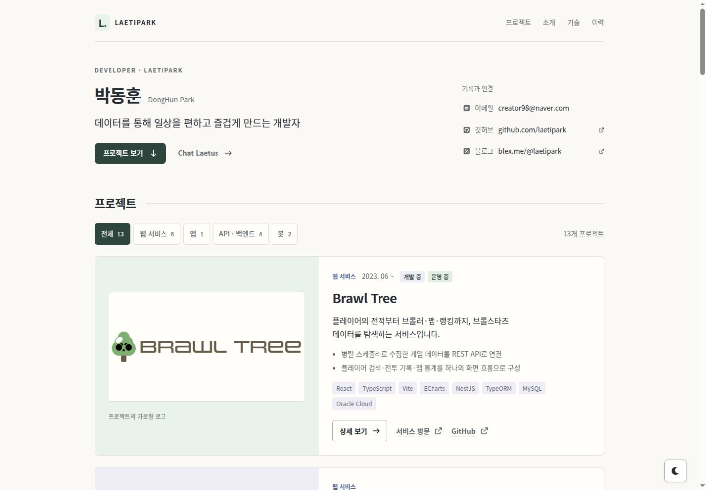

# Laetipark

데이터를 통해 일상을 편하고 즐겁게 만드는 개발자, **박동훈**의 포트폴리오입니다. 직접 만든 서비스와 개발 방식, 꾸준히 쌓아 온 학습 기록을 소개합니다.

[포트폴리오 보기](https://laetipark.github.io/) · [Chat Laetus 열기](https://laetipark.github.io/chat) · [프로젝트 작업 가이드](docs/README.md)

## 화면 미리보기



[데스크톱 전체 화면](docs/design/images/portfolio-desktop-light.jpg) · [모바일 화면](docs/design/images/portfolio-mobile-light.jpg) · [다크 모드](docs/design/images/portfolio-desktop-dark.jpg) · [Chat Laetus 모바일 화면](docs/design/images/chat-mobile-light.jpg)

화면 구성과 구현·검증 기록은 [포트폴리오 디자인 개편](docs/design/portfolio-redesign.md)에서 확인할 수 있습니다.

## 주요 기능

- 웹 서비스·앱·API·봇 13개 프로젝트를 분야별로 탐색하는 목록과 필터
- Brawl Tree·Sexynogi 대표 소개와 프로젝트별 이미지, 핵심 구현·기술·관련 링크
- 개발 방식, 학습 링크, 사용 기술, 학력과 활동을 연결하는 반응형 포트폴리오
- 키보드 탐색과 포커스 복귀를 지원하는 프로젝트 상세 모달
- 시스템 설정을 기본값으로 사용하고 선택을 저장하는 라이트·다크 테마
- 텍스트·이미지 첨부와 깊게 생각하기를 지원하는 Chat Laetus
- `/chat` 직접 접근을 복구하는 GitHub Pages용 SPA 라우팅

## 프로젝트 모아보기

| 분야               | 프로젝트                                                           | 주요 내용                                                           |
| ------------------ | ------------------------------------------------------------------ | ------------------------------------------------------------------- |
| 웹 서비스 · 6개    | Brawl Tree, Sexynogi, Orsem, Mystery Mango, UNINOTE, Blossom Stats | 게임 데이터·커뮤니티, 시장 정보 관측, 게임 제작·플레이, 학습 로드맵 |
| 앱 · 1개           | 산등성이                                                           | 주변 산·날씨와 산불위험예보 이력 조회                               |
| API · 백엔드 · 4개 | Chat Laetus · LaetiPark API, 돈이머니, 여기가자, 피드모아          | 대화 처리, 예산 관리, 위치 기반 음식점 탐색, 통합 피드              |
| 봇 · 2개           | Gowatch, Blossom Bot                                               | 집중 시간 기록, 게임 정보 조회와 브롤러 선택                        |

목록의 이미지는 프로젝트별 서비스 화면, 브랜드 로고, 데이터베이스 ERD와 UI 목업을 사용하며 캡션으로 종류를 구분합니다. 프로젝트 설명과 이미지의 출처는 [프로젝트 근거 자료](docs/design/project-sources.md)에 정리합니다.

## 로컬 실행

Node.js 24와 npm이 필요합니다.

```bash
npm ci
npm run dev
```

개발 서버가 출력한 주소에서 포트폴리오를 확인할 수 있습니다. Chat Laetus 백엔드는 이 저장소에 포함되지 않으므로, 채팅까지 사용하려면 `.env.example`을 참고해 `.env.local`에 계약과 호환되는 별도 API 주소를 설정합니다.

```dotenv
VITE_API_BASE_URL=https://your-api.example.com
```

이 값이 없어도 포트폴리오는 동작합니다. Chat Laetus에는 이용 불가 안내가 표시되고 메시지·이미지 전송 기능이 비활성화됩니다. `VITE_` 접두사가 붙은 값은 브라우저 번들에 포함되므로 비밀키를 넣지 않습니다. 자세한 계약은 [Chat Laetus API 규칙](docs/rules/API.md)을 확인합니다.

## 명령어

| 명령어              | 용도                          |
| ------------------- | ----------------------------- |
| `npm run dev`       | 개발 서버 실행                |
| `npm run typecheck` | TypeScript 타입 검사          |
| `npm run lint`      | ESLint 검사                   |
| `npm run build`     | 타입 검사 후 운영 번들 생성   |
| `npm run preview`   | 생성한 `dist/` 번들 미리 보기 |

## 기술 구성

| 영역         | 기술                          |
| ------------ | ----------------------------- |
| 애플리케이션 | React 19, TypeScript, Vite    |
| 스타일       | CSS Modules, 전역 디자인 토큰 |
| 아이콘       | Font Awesome                  |
| 품질 검사    | TypeScript, ESLint            |
| 코드 형식    | Prettier                      |
| 배포         | GitHub Actions, GitHub Pages  |

## 프로젝트 구조

```text
src/
├── common/       # API, 데이터, 전역 스타일, 공통 타입
├── components/   # 공통·레이아웃·기능별 컴포넌트
├── pages/        # 화면 단위 컴포넌트
└── assets/       # 이미지와 CSS Modules
public/           # 정적 자산과 GitHub Pages 404 복구 문서
docs/             # 작업 가이드, 규칙 정본, 화면·검증 기록
```

구현이나 문서를 변경하기 전에는 [프로젝트 작업 가이드](docs/README.md)에서 작업에 맞는 규칙 문서를 선택해 읽습니다.

## Chat Laetus 데이터 안내

입력한 메시지와 첨부 이미지, 클라이언트 세션 ID, 응답 뒤 이어지는 대화 ID와 선택 입력한 닉네임은 설정된 API로 전송됩니다. 닉네임과 마지막 대화 스냅샷은 대화를 이어 갈 수 있도록 브라우저 `localStorage`에 저장됩니다. 화면에는 마지막 사용자 질문과 그 이후의 응답을 표시합니다.

대화 초기화는 브라우저의 마지막 대화 스냅샷만 삭제하고 닉네임과 서버 데이터를 삭제하지 않습니다.

서버의 저장 범위와 보관 기간은 이 프론트엔드 저장소에서 정의하지 않습니다. 민감한 개인정보는 입력하지 않는 것을 권장합니다.

## 배포

`main` 브랜치에 push하면 [GitHub Actions 워크플로](.github/workflows/deploy.yml)가 의존성 설치와 빌드를 거쳐 GitHub Pages에 배포합니다. 운영 채팅 API 주소는 저장소 secret `VITE_API_BASE_URL`로 주입합니다.

배포 경로와 SPA 라우팅 제약은 [배포 규칙](docs/rules/DEPLOYMENT.md)을 따릅니다.

## 연락처

- GitHub: [@laetipark](https://github.com/laetipark)
- 기술 블로그: [blex.me/@laetipark](https://blex.me/@laetipark)
- 이메일: [creator98@naver.com](mailto:creator98@naver.com)
