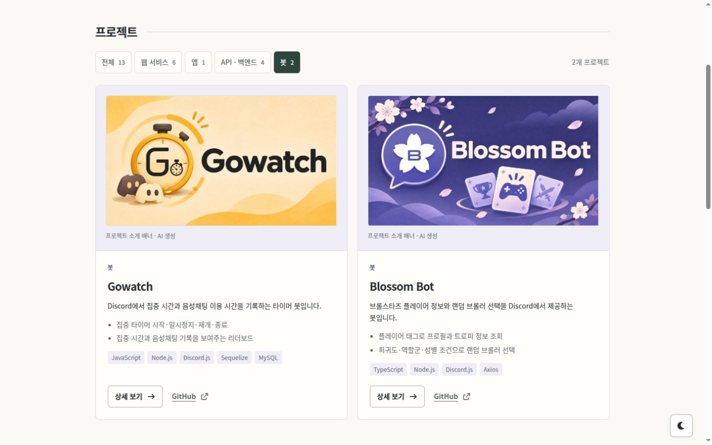

# 프로젝트 소개 배너 제작

[디자인 개편 기록](portfolio-redesign.md) · [이미지 출처](project-sources.md) · [최종 프롬프트](banner-prompts.json)

2026-11-07 사용자 요청에 따라 배너가 없던 다섯 프로젝트의 소개 이미지를 제작했습니다. **내장 `image_gen` 도구**를 사용했으며, 완성 PNG는 모두 **1672×941px**입니다. 포트폴리오에서는 기존 카드와 같은 **16:9** 영역에 `scale-down`으로 표시해 자르거나 늘리지 않습니다.

## 디자인과 저장 위치

| 프로젝트    | 표현 방향                                             | 완성 파일                                                                        |
| ----------- | ----------------------------------------------------- | -------------------------------------------------------------------------------- |
| Chat Laetus | 짙은 초록, 민트·라벤더 대화 말풍선과 이미지 입력 상징 | [chat-laetus-banner.png](../../src/assets/projects/chat-laetus-banner.png)       |
| UNINOTE     | 하늘색·아이보리, 열린 노트와 연결된 마인드맵          | [uninote-banner.png](../../src/assets/projects/uninote-banner.png)               |
| 산등성이    | 기존 웃는 해·산 로고, 초록 능선과 산책길              | [happy-mountain-banner.png](../../src/assets/projects/happy-mountain-banner.png) |
| Gowatch     | 기존 G·스톱워치 모티프, 노란색과 집중 시간의 흐름     | [gowatch-banner.png](../../src/assets/projects/gowatch-banner.png)               |
| Blossom Bot | 기존 벚꽃 B 심볼, 보라색 말풍선과 게임 카드           | [blossom-bot-banner.png](../../src/assets/projects/blossom-bot-banner.png)       |

산등성이·Gowatch·Blossom Bot은 저장소의 기존 로고를 참조했습니다. UNINOTE는 기존 화면의 하늘색을, Chat Laetus는 포트폴리오의 초록·민트·라벤더를 사용했습니다. 공통으로 큰 프로젝트명, 부드러운 종이 질감과 여백을 사용하되 각 프로젝트의 주제를 구분했습니다.

프롬프트의 요청 해상도와 생성 도구의 실제 출력은 다를 수 있어, 배포 전 PNG 헤더와 브라우저의 `naturalWidth`·`naturalHeight`로 다섯 파일이 모두 같은 크기임을 확인했습니다. 최종 문구와 참조 자산은 [프롬프트 기록](banner-prompts.json)에 보관합니다.

이 이미지는 프로젝트를 소개하는 일러스트이며 실제 제품 화면이나 기능 시연이 아닙니다. 목록과 상세의 캡션은 `프로젝트 소개 배너 · AI 생성`으로 구분합니다. 기존 화면·로고·ERD는 상세 이미지로 보존합니다.

## 프로젝트 README 반영

UNINOTE는 웹과 Android가 하나의 프로젝트이므로 같은 PNG를 두 저장소에 사용합니다. 각 저장소의 변경은 README의 H1 다음 배너 한 줄과 이미지 파일 하나로 한정하며, 기존 설명과 로고는 보존합니다.

| 저장소          | README                                                                         | 배너 경로                              |
| --------------- | ------------------------------------------------------------------------------ | -------------------------------------- |
| LaetiPark API   | [README](https://github.com/laetipark/laetipark-api/blob/master/README.md)     | `docs/assets/laetipark-api-banner.png` |
| UNINOTE 웹      | [README](https://github.com/laetipark/uninote-web/blob/master/README.md)       | `docs/images/project-banner.png`       |
| UNINOTE Android | [README](https://github.com/laetipark/uninote-app/blob/master/README.md)       | `docs/images/project-banner.png`       |
| 산등성이        | [README](https://github.com/laetipark/happy-mountain/blob/master/README.md)    | `docs/images/project-banner.png`       |
| Gowatch         | [README](https://github.com/laetipark/gowatch-bot/blob/master/README.md)       | `public/gowatch-banner.png`            |
| Blossom Bot     | [README](https://github.com/laetipark/brawltree-discord/blob/master/README.md) | `images/blossom-banner.png`            |

## README 반영 커밋

| 저장소          | master 반영 커밋                                                                                          |
| --------------- | --------------------------------------------------------------------------------------------------------- |
| LaetiPark API   | [912a8fa](https://github.com/laetipark/laetipark-api/commit/912a8faf3554e5034dc8bee85f10240b7b258c82)     |
| UNINOTE 웹      | [83b217b](https://github.com/laetipark/uninote-web/commit/83b217b2f9531de8914c82da2e269d4a539fb5e4)       |
| UNINOTE Android | [fc89810](https://github.com/laetipark/uninote-app/commit/fc89810dcbfa338e5ffad7b9c86bf2e27205f655)       |
| 산등성이        | [0467fac](https://github.com/laetipark/happy-mountain/commit/0467facb6e0b4705b515a34b666f3a5c92b91f4c)    |
| Gowatch         | [6be924d](https://github.com/laetipark/gowatch-bot/commit/6be924db459e95acf6a3f2d20465300815eafda8)       |
| Blossom Bot     | [11a14da](https://github.com/laetipark/brawltree-discord/commit/11a14da68055407ce11e9c080a131fb9a138316a) |

각 원격 HEAD와 README·이미지 blob이 검증한 로컬 커밋과 동일함을 확인했습니다. 강제 푸시 없이 반영했으며 커밋마다 변경 파일은 두 개입니다.

## 검증

- PNG 다섯 개의 실제 해상도와 프로젝트명·한글 표기·로고 모티프를 확인했습니다.
- 전체 13개 프로젝트를 표시한 상태에서 320·390·768·1024·1440px 라이트·다크 화면의 가로 넘침이 없음을 확인했습니다.
- 새 배너 다섯 개가 데스크톱 일반 카드에서 모두 같은 468×263.25px 영역에 표시되는 것을 확인했습니다. 화면이 좁아지면 같은 비율로 함께 축소됩니다.
- 상세 모달에서 새 배너와 기존 로고가 각각 표시되며 이미지 원본 링크와 닫은 뒤 포커스 복귀가 유지되는 것을 확인했습니다.
- `npm run lint`, `npm run build`를 통과했습니다.

