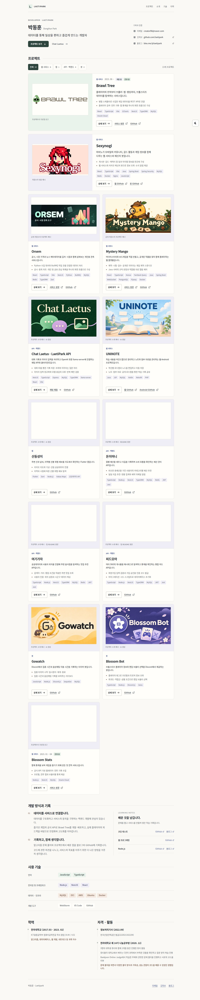
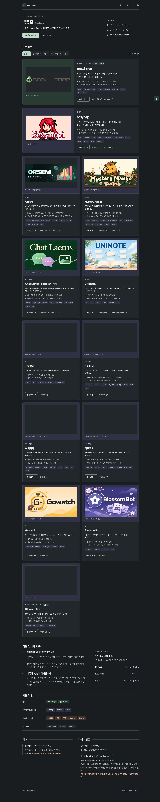
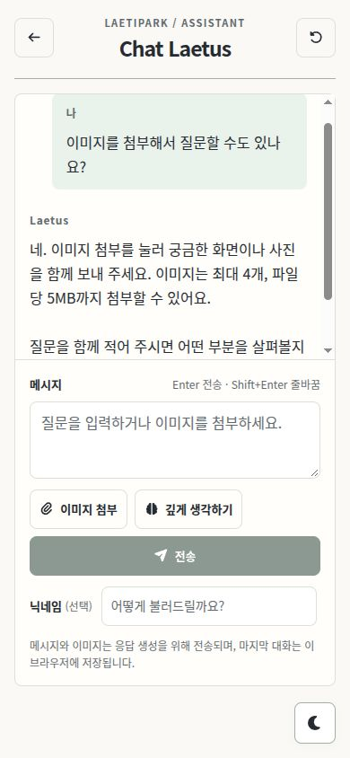
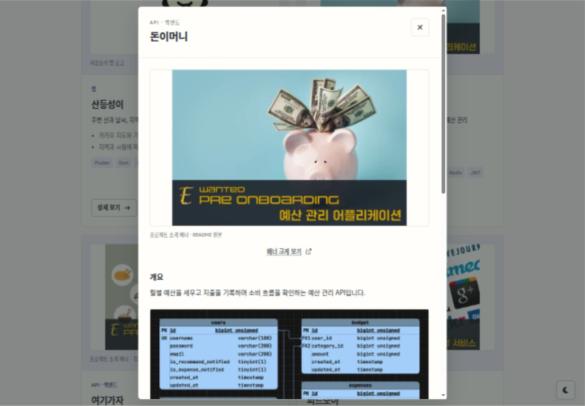
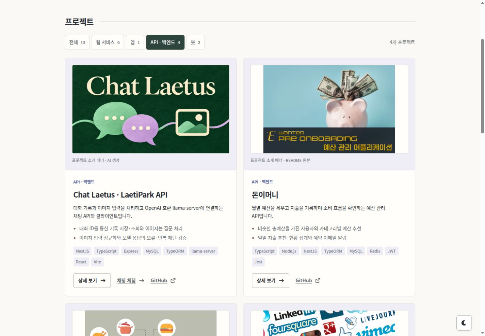

# 포트폴리오 디자인 개편

[프로젝트 작업 가이드](../README.md) · [디자인 규칙](../rules/DESIGN.md) · [저장소 소개](../../README.md) · [프로젝트·배너 출처](project-sources.md)

개발자 개인 브랜드를 중심으로 프로젝트, 개발 방식과 학습 기록이 이어지는 에디토리얼 포트폴리오를 구현합니다. 이 문서는 화면 구성과 개편 과정의 기록입니다. 계속 적용할 디자인 기준은 [디자인 규칙](../rules/DESIGN.md), 데이터·컴포넌트 계약은 [프론트엔드 규칙](../rules/FRONTEND.md)에 둡니다.

## 화면 구성

### 메인 포트폴리오

```text
LAETIPARK                   프로젝트 · 소개 · 기술 · 이력
────────────────────────────────────────────────────────
박동훈
데이터를 통해 일상을 편하고 즐겁게 만드는 개발자
[프로젝트 보기]              GitHub · 블로그 · 이메일
Chat Laetus →

프로젝트 13개 · 전체 / 웹 / 앱 / API·백엔드 / 봇
┌────────────────────────┬─────────────────────────────┐
│ 프로젝트 배너          │ Brawl Tree                  │
│                        │ 기간 · 개발/운영 상태       │
│                        │ 프로젝트 요약               │
│                        │ 핵심 구현 · 기술 환경       │
│                        │ [상세 보기] [서비스 방문]   │
└────────────────────────┴─────────────────────────────┘
Sexynogi — 같은 구성의 대표 프로젝트

Orsem              Mystery Mango
Chat Laetus        UNINOTE
산등성이           돈이머니
여기가자           피드모아
Gowatch            Blossom Bot
Blossom Stats
(배너 · 요약 · 핵심 구현 · 기술 · 상세/저장소 링크)

개발 방식                     학습 기록
데이터를 서비스로 연결하기     코딩 테스트 · 웹 · Node.js
사용자 피드백과 기록

사용 기술
언어 / 프레임워크 / 데이터·인프라 / 개발 도구

학력                          자격·활동
────────────────────────────────────────────────────────
GitHub · 블로그 · 이메일                           [테마]
```

모바일에서는 프로젝트 이미지와 설명, 소개와 학습 기록, 이력을 한 열로 쌓습니다. 메뉴와 연락처는 줄바꿈하고 학습 링크는 바로 보여줍니다. 프로젝트 상세를 열기 전에도 어떤 서비스이며 무엇을 구현했는지 읽을 수 있게 구성합니다.

### 프로젝트 상세

```text
프로젝트 이름 · 기간 · 상태                         [닫기]
────────────────────────────────────────────────────────
프로젝트 배너 → 개요 → 실제 화면·ERD
담당 역할 → 주요 기능 → 구현 과정 → 기술 환경
[이미지 원본 보기] [서비스 방문] [GitHub]
```

기존 자료의 사실과 링크를 보존하면서 사례를 읽는 순서로 설명을 정리합니다. 상세는 모달로 제공하고 키보드 접근, 배경 조작 제한과 닫힌 뒤 포커스 복귀를 함께 처리합니다.

### Chat Laetus

```text
[포트폴리오로]         Chat Laetus              [초기화]
────────────────────────────────────────────────────────
짧은 이용·저장 안내

사용자 질문
Laetus 응답 / 응답 준비 상태

오류 또는 첨부 미리보기
┌──────────────────────────────────────────────────────┐
│ 메시지를 입력하세요                                  │
└──────────────────────────────────────────────────────┘
[이미지 첨부] [깊게 생각하기]                    [전송]
닉네임: 선택 입력
```

입력 도구는 모바일에서도 메시지 입력과 전송을 빠르게 찾을 수 있게 묶습니다. API가 설정되지 않은 환경에서는 이용 불가 안내를 보여줍니다. API와 저장 키, 이미지 제한, 마지막 질문과 그 이후 응답을 보여주는 방식은 [기존 계약](../rules/API.md)을 유지합니다.

## 화면 캡처

아래 캡처는 13개 프로젝트와 원본 배너를 반영한 로컬 구현 화면입니다. Chat Laetus 캡처는 통제된 로컬 API의 예시 응답을 사용합니다. 배너·로고·UI·ERD의 원본은 [프로젝트 출처](project-sources.md)에 기록했습니다.

### 데스크톱 · 라이트



### 모바일 · 라이트


### 데스크톱 · 다크



### Chat Laetus · 모바일



### 프로젝트 상세 · 배너와 ERD



### 프로젝트 배너 목록



## 구현 순서

1. 공통 토큰, 타이포그래피, 레이아웃과 버튼·포커스 스타일을 정리합니다.
2. 대표 프로젝트를 앞에 배치하고 소개, 학습 기록, 기술과 이력을 재구성합니다.
3. 프로젝트 상세의 읽기 순서와 모달 접근성을 개선합니다.
4. 채팅 입력기와 초기·응답 준비·오류·설정 누락 상태를 정리합니다.
5. README와 규칙 문서를 실제 구현에 맞추고 화면 캡처·검증 결과를 기록합니다.
6. 후속 요청에 따라 공개 GitHub 프로젝트를 조사하고, 관련 저장소를 13개 프로젝트로 묶어 분류·역할·배너·이미지 출처를 정리했습니다.
7. `main` 반영과 GitHub Actions 운영 배포까지 범위를 확장했습니다. 공식 경로는 [배포 규칙](../rules/DEPLOYMENT.md)을 따릅니다.

## 검증 기록

검증일: **2026-11-07**. 실제 브라우저와 로컬 테스트 API로 확인했습니다.

| 확인 항목     | 결과                                                                                                                                                                   |
| ------------- | ---------------------------------------------------------------------------------------------------------------------------------------------------------------------- |
| 정적 검사     | `npm run lint`, `npm run build`, `git diff --check` 통과                                                                                                               |
| 반응형·테마   | 320·390·768·1024·1440px의 메인·채팅 라이트/다크에서 가로 넘침 없음                                                                                                     |
| 포트폴리오    | 섹션 앵커·뒤로 가기 확인. 기존 연락처·서비스·학습 URL과 이력 보존                                                                                                      |
| 프로젝트 상세 | 키보드 열기, Tab/Shift+Tab 순환, Escape·닫기, 포커스 복귀와 배경 스크롤 잠금 확인                                                                                      |
| 라우팅        | 로컬 `/`, `/chat` 직접 접근·새로고침과 화면 간 이동 확인. 상세 모달에서 `/chat` 이동 후 배경 제한 해제 확인                                                            |
| 채팅 응답     | 로컬 mock API로 성공·지연·503 오류, 깊게 생각하기, 중복 전송 및 대기 중 초기화 차단 확인                                                                               |
| 채팅 첨부     | 브라우저에서 5MB 초과 차단, 5개 선택 시 4개 제한, 이미지 전용 전송·복원 확인. 320×480px에서도 전송 가능                                                                |
| 입력·용량     | 실제 이벤트 핸들러를 임시 harness에서 실행해 12,000,000자 제한과 비이미지 차단, IME 조합 중 Enter 예외 확인. 브라우저에서 한글 문자열·Shift+Enter 개행·Enter 전송 확인 |
| 채팅 저장     | 새로고침 후 메시지·이미지·닉네임 복원, 초기화 후 닉네임 유지, 마지막 질문과 그 이후 응답만 표시 확인                                                                   |
| 문서          | 캡처 경로, 로컬 링크와 실제 npm 명령 대조                                                                                                                              |

채팅 검증은 별도의 로컬 API에서 수행했으며 운영 서비스로 테스트 대화를 전송하지 않았습니다. OS 한글 입력기의 실제 조합 이벤트와 운영 서버 연결은 별도로 확인하지 않았습니다. 모션 줄이기 설정은 자동 스크롤과 CSS 전환에 반영했습니다.

프로젝트 확장 후 전체 13개가 표시된 상태에서 320·390·768·1024·1440px 라이트·다크를 다시 검사해 가로 넘침과 카드 내부 잘림이 없음을 확인했습니다. 필터 개수(6·1·4·2), 대표 배너와 상세 이미지의 분리, 원본 보기 링크, 모달의 키보드 순환·포커스 복귀를 확인했습니다.

배포 대상은 [운영 포트폴리오](https://laetipark.me/)이며, 배포 실행 이력은 [GitHub Actions](https://github.com/laetipark/laetipark.github.io/actions/workflows/deploy.yml)에서 확인합니다.

운영 배포 후 GitHub Pages 주소에서 사용자 도메인으로의 연결, 13개 프로젝트 표시, `/chat` 직접 접근·새로고침·뒤로 가기를 확인했습니다. 채팅 입력은 운영 API 설정을 인식해 활성화되며, 운영 API에 테스트 메시지는 전송하지 않았습니다. 포트폴리오로 되돌아오는 Sexynogi의 이전 서비스 링크는 제거하고 저장소 링크를 유지했습니다.

## 소개 배너 후속 적용

2026-11-07 후속 요청으로 Chat Laetus·UNINOTE·산등성이·Gowatch·Blossom Bot의 배너를 제작했습니다. 다섯 PNG의 원본 크기는 1672×941px로 같으며 목록은 기존 16:9 영역을 유지합니다. 실제 화면과 로고는 상세에 보존했습니다. 배너 파일, 프롬프트, 저장소 README 반영과 검증 결과는 [생성 배너 기록](generated-banners.md)에 정리합니다.
